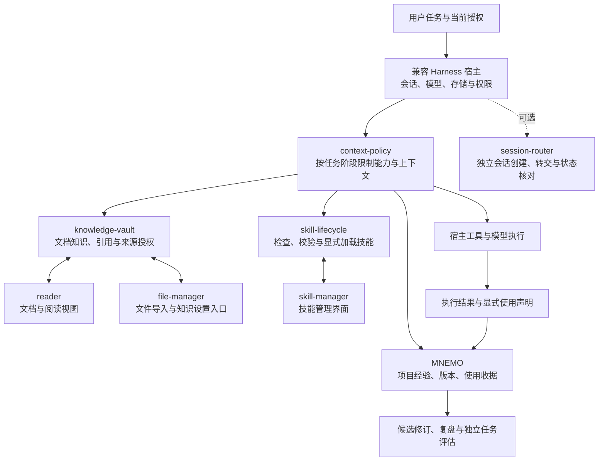

# Harness Memory Suite

一套面向兼容 DeepSeek Harness 宿主的记忆、知识、技能与工具编排插件。它把“保留什么经验”“当前任务能读取什么”“何时加载技能和工具”“怎样确认经验确实被采用”连接到同一条任务流程中。

当前适配 **DeepSeek Harness 0.2.1-rc.2**，适合在隔离宿主上部署和验证。仓库包含 **8 个插件模块、宿主兼容补丁、合成测试与接入脚本**。运行它需要已有的兼容宿主；本仓库没有独立的 Web 服务启动器，也不包含宿主发行版、模型账号或业务数据。

更新：适配 Harness RC2，更新工具契约与前向维护流程，并验证任务执行、状态更新及跨会话记忆复用。

## 导航

- [研究与经验学习状态](#研究与经验学习状态)
- [架构与任务流程](#架构与任务流程)
- [模块与功能](#模块与功能)
- [环境与兼容性](#环境与兼容性)
- [安装与部署](#安装与部署)
- [使用方法](#使用方法)
- [配置参考](#配置参考)
- [验证与故障排查](#验证与故障排查)
- [数据、升级与隐私](#数据升级与隐私)
- [当前边界与许可证](#当前边界与许可证)

## 研究与经验学习状态

本项目的经验学习设计、论文与数学模型借鉴已单独公开，见[研究导航](docs/research/README.md)、[22 项原始文献与适用限制](docs/research/REFERENCES.zh-CN.md)及[完整框架方案](docs/research/EXPERIENCE-LEARNING-DESIGN.zh-CN.md)。这些是可检验的工程设计，不表示复现了全部论文，也不涉及底层模型权重训练。

首个[工具激活时序实验](docs/research/ACTIVATION-TIMING-PILOT.zh-CN.md)跑通了采集、条件候选、人工审核和冻结对照。原冻结批存在包装器失败，事后修复诊断与原结果分账；小样本信号不能推广为生产收益。生产影子接入和运行验收以[状态记录](docs/research/STATUS.zh-CN.md)为准，自动行动注入、自动晋级和技能自动注册仍关闭。

## 架构与任务流程



### 三类内容各司其职

|类型|保存什么|如何使用|
|---|---|---|
|记忆|项目约定、经过筛选的任务经验、纠正记录|按项目作用域检索，保留版本、来源和采用声明|
|知识|文档、文件引用、分片、目录与阅读内容|先检索摘要，再读取带来源和版本的有限片段|
|技能|`SKILL.md` 中可重复执行的操作流程|先检查有效来源和修订，再显式加载正文|

一次典型任务的流程如下：

1. 宿主确定当前会话、工作目录和用户授权；当前轮次关闭记忆、知识或工具的要求进入约束。
2. 简单任务直接执行。只有存在能力缺口时，才搜索工具或技能摘要；需要旧经验时再检索相关记忆或知识。
3. `context-policy` 控制阶段内启用的工具、技能和知识片段。搜索到能力不等于获得权限，也不等于服务已经连通。
4. 工具执行仍经过宿主权限与结果校验。来源授权、版本或项目上下文发生变化时，读取结果会重新检查。
5. MNEMO 将捕获内容先纳入暂存和筛选流程；模型若采用了某条已展示的记忆，需要通过收据声明采用原因。
6. 修订、技能草稿和任务复盘进入相应候选流程。模型声明、召回次数和工具成功都不能单独证明经验带来了任务收益。

默认阶段上限为 **24 个扩展工具、2 个技能、5 个知识片段**。阶段结束可以释放扩展能力；这不会删除真实会话历史。新轮次或重启后，扩展能力需要重新启用，用户禁用约束仍须恢复。

## 模块与功能

|目录|主要功能|接入说明|
|---|---|---|
|[`packages/mnemo`](packages/mnemo)|暂存捕获、项目隔离、相关性检索、工作记忆、来源与版本链、纠错、使用收据、候选评估和复盘|需要独立可写数据目录；同一数据目录采用单写者锁|
|[`packages/knowledge-vault`](packages/knowledge-vault)|知识记录与历史版本、集合/目录、关键词检索、可配置向量与重排、OCR、引用、来源授权和回收站|依赖宿主 `storageDomain`、工具及会话上下文|
|[`packages/reader`](packages/reader)|小说、剧本、漫画和文档阅读；导入 TXT、Markdown、DOCX、EPUB、PDF；章节分页和修订管理|读取源文件前须配置允许的来源根；部分处理能力依赖知识服务或原生工具|
|[`packages/file-manager`](packages/file-manager)|目录浏览、预览、复制/剪切/粘贴、移动、重命名、回收站、文件导入与知识设置界面|应显式设置文件根目录和读写权限；客户端入口依赖宿主 UI 服务|
|[`packages/dsh-skill-lifecycle`](packages/dsh-skill-lifecycle)|技能草稿验证、有效来源与修订核对、显式加载、能力摘要检索|包装官方技能工具；接入时应替换相应工具挂载，避免重复注册|
|[`packages/dsh-skill-manager`](packages/dsh-skill-manager)|查看、编辑、启停技能文件，识别同名来源和会话实际生效内容|管理目录必须与宿主技能文件提供器和 Registry 的配置一致|
|[`packages/context-policy`](packages/context-policy)|工具发现与阶段激活、技能和知识读取预算、提示词投影、任务流程指导、禁用约束恢复|必须与 `dsh-skill-lifecycle` 保持相邻目录，并使用兼容 ToolRuntime|
|[`packages/session-router`](packages/session-router)|列出、创建和转交独立会话，查询投递状态，可选模型切换|可选；依赖额外会话控制服务，固定桥接不匹配时关闭相应功能|

宿主兼容补丁 [`patches/dsh-tools-compat.patch`](patches/dsh-tools-compat.patch) 补充工具结果重新校验和能力可用性过滤。它是部分模块的必要契约；仅安装插件文件而未满足该契约，不能得到相同行为。

## 环境与兼容性

### 基础要求

- Node.js：建议以本仓库验证过的 **22.x、且不低于 22.19** 为基线；其他版本需要自行验证。
- npm、Git、`patch`；下面部署示例还使用 Bash 和 `tar`。
- Python 3：完整测试和 DOCX/EPUB 本地解析会使用标准库 ZIP/XML 处理。
- PDF 文本/渲染和本地 OCR 按需使用 Poppler、Tesseract 及相应语言数据。缺少这些工具时，相关能力不可用，部分测试会明确跳过。

### 固定宿主契约

|依赖|本仓库的开发验证版本|
|---|---|
|`@deepseek-ai/dsh-tools` 及根清单中的其他 `@deepseek-ai/dsh-*` SDK|`0.2.1-rc.2`|
|`@deepseek-ai/cordis`|`4.0.5`|
|`@deepseek-ai/cordis-plugin-loader`|`1.0.6`|
|`@deepseek-ai/schemastery`|`3.18.5`|

完整依赖以 [`package.json`](package.json) 和 [`package-lock.json`](package-lock.json) 为准。这是对 **SDK 版本和接口** 的约束，不代表任意同名宿主发行版都兼容。

宿主需提供工具运行时、系统提示词、会话/代理上下文与持久存储；Web 功能还需已认证的连接路由和客户端插件加载器。技能功能需宿主技能 Registry、文件提供器、工作目录等服务；模型维护任务需要宿主模型服务，交互纠错和复盘还会使用用户提问服务。可选会话路由需要更多控制、审批、工作区与投影服务，详见其 [`inject` 声明](packages/session-router/index.js)。

## 安装与部署

以下步骤先在隔离宿主和空数据目录执行。路径由部署者自行选择，示例不包含任何现有机器配置。

### 1. 获取源码并验证

从 GitHub 页面 **Code** 菜单复制本仓库的 HTTPS 克隆地址，填入 `REPO_URL`：

```bash
REPO_URL='<本仓库的 HTTPS 克隆地址>'
git clone "$REPO_URL" harness-memory-suite
cd harness-memory-suite
npm ci --ignore-scripts
npm run prepare:host
npm run verify
```

这里的 `prepare:host` **只给本仓库 `node_modules` 中的开发 SDK 副本打补丁**，不会自动找到或修改已运行的宿主。补丁脚本检查版本、补丁摘要和全部目标文件校验和；未知基线拒绝覆盖，目标内容已匹配时幂等退出。

`npm run build` 可单独构建文件管理客户端。仓库也保留阅读器随包发行的客户端和第三方资源，但不声称包含这些预构建产物的完整原始 UI 构建工程。

### 2. 选择宿主目录和数据目录

将以下占位路径替换为自己的绝对路径：

```bash
export HOST_ROOT='/absolute/path/to/compatible-host'
export HOST_PLUGIN_ROOT="$HOST_ROOT/custom-plugins"
export HOST_DATA_ROOT='/absolute/path/to/local-plugin-data'
export MEMORY_DATA_ROOT="$HOST_DATA_ROOT/memory"
export LOCAL_CONFIG_FILE="$HOST_DATA_ROOT/plugin-entries.json"
export HOST_TOOLS_PACKAGE="$HOST_ROOT/node_modules/@deepseek-ai/dsh-tools"

mkdir -p "$HOST_PLUGIN_ROOT" "$MEMORY_DATA_ROOT" \
  "$HOST_DATA_ROOT/files" "$HOST_DATA_ROOT/reader"
```

`HOST_ROOT` 必须是已安装兼容宿主的实际目录。上面的 SDK 路径只适用于该目录下直接安装依赖的布局；其他布局应把 `HOST_TOOLS_PACKAGE` 改为**宿主实际解析到的 SDK 包目录**。

插件模块的 Node.js 依赖解析应最终指向宿主使用的同一套 SDK。不要把本仓库的开发 `node_modules` 复制进插件部署目录，也不要为每个插件各安装一份 SDK。若插件根不在宿主依赖解析链内，需先通过宿主支持的包/模块加载方式解决依赖解析。

### 3. 导出插件并准备宿主补丁

在源码仓库根目录运行下列命令，向**新建的空插件目录**导出已提交版本的全部模块：

```bash
set -euo pipefail
git archive HEAD:packages | tar -x -C "$HOST_PLUGIN_ROOT"
node scripts/apply-host-compat.mjs --package-root "$HOST_TOOLS_PACKAGE"
```

目录内虽含可选路由文件，但默认配置不会加载它。保留各模块原目录名，尤其是 `context-policy` 与 `dsh-skill-lifecycle` 的相邻关系。

显式 `--package-root` 会修改选定 SDK 包。给现有宿主升级前，应安排停止相关进程的维护窗口；不要依赖运行中的模块热替换来完成升级。脚本先在临时目录应用并验证当前版本补丁，再复核目标摘要并替换文件，不保留旧软件版本或自动回切。失败时保持停机并修复当前版本；临时文件清理不代表多文件写入具备事务性。配置与业务数据应独立保护。

### 4. 生成并收紧本地配置

```bash
node scripts/write-host-config.mjs \
  --plugins-root "$HOST_PLUGIN_ROOT" \
  --memory-root "$MEMORY_DATA_ROOT" \
  --out "$LOCAL_CONFIG_FILE"
```

生成器检查入口文件，创建权限为 `0600` 的 **Cordis 插件数组草稿**，已存在的输出会被拒绝。它不会安装插件、启动服务或覆盖宿主主配置。若确实需要可选会话路由，可在首次生成时附加 `--router`。

生成器只自动填写记忆目录。首次部署还应显式限制文件访问，并给阅读器选择存储目录。例如执行下面这段代码，修改刚生成的本地草稿：

```bash
node --input-type=module <<'JS'
import { readFileSync, writeFileSync } from 'node:fs';
import { join } from 'node:path';
const file = process.env.LOCAL_CONFIG_FILE;
const data = process.env.HOST_DATA_ROOT;
if (!file || !data) throw new Error('请先设置部署目录环境变量');
const entries = JSON.parse(readFileSync(file, 'utf8'));
for (const entry of entries) {
  if (entry.id === 'file-manager') {
    entry.config = { root: join(data, 'files'), writable: false, trash: true };
  }
  if (entry.id === 'reader') {
    entry.config = {
      storageDir: join(data, 'reader'),
      sourceRoots: [join(data, 'files')],
    };
  }
  if (entry.id === 'session-router') {
    entry.config = { enabled: true, maxMessageChars: 4000, allowCrossRoot: false };
  }
}
writeFileSync(file, JSON.stringify(entries, null, 2) + '\n', { mode: 0o600 });
JS
```

这里让文件管理先只读，且只暴露专门的文件目录。需要复制、移动或回收站写入时，再由操作者将 `writable` 改为 `true`。默认根目录和默认读写权限不适合替代部署者自己的访问范围选择。

### 5. 接入宿主后端与客户端

把草稿中的条目合并到宿主支持的插件配置中。插件应挂在能取得所需服务、并能覆盖目标代理/会话的正确实例或模板作用域。不要直接用草稿覆盖整份宿主配置，也不要重复挂载已有知识库、记忆插件或官方技能工具。

对于已经初始化好服务的 Cordis Loader，后端程序化加载形式如下；`hostContext` 代表已有宿主上下文，这**不是独立启动脚本**：

```js
import { readFile } from 'node:fs/promises';
const entries = JSON.parse(await readFile(localConfigFile, 'utf8'));
for (const entry of entries) await hostContext.loader.create(entry);
await hostContext.loader.await();
```

`localConfigFile` 是上一步生成的本地文件。文件数组只负责后端条目；采用何种配置包含机制和作用域，取决于宿主的加载配置。

**Web 界面还需单独核对客户端加载：**让宿主识别相关包 `package.json` 中的 `dsh.client`/客户端导出声明。只加载 `index.js` 不保证会自动加载浏览器模块。文件管理界面使用宿主应用入口和设置服务，技能管理和阅读器使用宿主 UI 插槽、布局等服务。后端正常但图标不出现时，应检查客户端模块、注入服务和浏览器控制台。

`dsh-skill-lifecycle` 包装官方技能工具，应替换同一作用域内相应的官方工具挂载；技能 Registry 和文件提供器仍由宿主提供。管理界面能看到技能文件，不代表当前会话已经从该来源加载了技能。

完成后使用宿主自己的启动/重载流程，并执行下方验收。更详细的接入边界见 [INTEGRATION](docs/INTEGRATION.md)。

### 6. 配置知识处理与模型入口

先验证本地关键词检索和文档读取，再按需在文件管理的知识设置界面配置远程能力：

|能力|配置重点|
|---|---|
|文本与视觉处理|可使用宿主已配置路由或设置界面提供的独立路由；需核对所选模型输入能力|
|向量检索|选择受支持协议、端点、模型和维度；图片向量需额外启用图片能力|
|重排|选择目录中对应协议及其凭据类型，不能把所有供应商当成同一个请求格式|
|OCR|区分本地 OCR、视觉模型转写和专用 OCR 接口；按实际凭据及支持格式配置|

协议和预设以 [`provider-catalog.js`](packages/knowledge-vault/lib/provider-catalog.js) 为准。远程预设默认禁用；文本模型中的 `configure-…-text-model` 是占位符，必须替换后才能启用。这里的知识处理路由配置不等于给宿主安装通用模型协议适配器。

凭据只填写在部署者自己的宿主/知识设置中。远程索引或检索可能发送所选文档内容并产生费用；相关调用仍需显式授权，启用供应商不代表授权批量处理整个知识库。

## 使用方法

### 工具与技能：先发现，再按需启用

在宿主对话中描述任务，让代理根据需要调用以下工具；这些是模型工具，**不是终端命令**：

|步骤|工具|作用|
|---|---|---|
|发现能力|`search_capabilities`|搜索工具或技能摘要；`kind` 可选 `tool` 或 `skill`|
|启用工具|`activate_tool_group`|优先传具体 `tools` 列表，下一个执行步骤生效；扩展已有阶段时给出 `reason`|
|检查技能|`skill_check`|确认本会话实际生效来源、路径与修订，不加载正文|
|校验草稿|`skill_validate`|检查拟写入的 `SKILL.md`，不执行、不自动安装|
|加载技能|`skill`|显式读取技能正文，保留原有调用权限约束|
|结束阶段|`release_capabilities`|释放扩展能力和读取预算，保留必要结论、来源及证据摘要|

例如用户要求“检查当前项目文档，再根据对应流程修复问题”，代理可以先搜索文档工具，启用所需的具体工具，读取相关内容；只有匹配专用流程时才加载技能。无需每次任务都重新配置已持久化的宿主连接，但连接是否真实可用仍以执行结果为准。

### 添加自己的技能

在宿主已注册的可写技能根中，按 `<技能根>/example-document-check/SKILL.md` 放置文件，或从技能管理界面创建。最小示例：

```markdown
---
name: example-document-check
description: 当用户明确要求检查项目说明文档是否与代码一致时使用。
---

# 检查项目说明文档

1. 阅读用户指定的说明文档及对应入口代码。
2. 核对配置字段、命令和相对链接，记录可复现的不一致。
3. 仅在用户授权修改时修正文档，并验证受影响的示例。
```

`name` 使用小写字母、数字和连字符；把主要触发条件写入 `description`。保存后，让代理通过 `skill_check` 核对有效来源与修订，再调用 `skill` 加载。若同名文件被项目来源覆盖，应解决来源选择，不能仅以界面中某个文件的内容作为生效依据。

### 知识与文件：授权来源，引用片段

1. 把自有测试文档放入配置的文件根；在文件管理/知识界面选择文件或目录导入。导入记录保留来源引用，不会自动移动原文件。
2. 确认当前项目能访问该条目及其来源授权；“记录存在”不等于当前会话获准读取。
3. 使用 `search_knowledge` 做受限检索，或通过阶段化 `search_experience` 获得摘要，再以 `read_knowledge_fragment` 读取确切片段。
4. 片段受检索标识、当前代理、阶段、版本和授权绑定。过期或撤权后应重新检索，不能重放旧片段请求。
5. 需要向量索引时，使用知识界面或 `index_knowledge` 处理明确选中的记录；只在授权允许时开启 `allow_remote`。

阅读器可通过 `reader_import_document` 导入允许来源根内的文档，用 `reader_get_book`、`reader_list_parts`、`reader_read_chapter` 分页读取。导入和修改工具有请求 ID、版本与访问上下文要求；让代理按宿主实际工具 schema 调用，不要猜参数。

### 记忆：检查、纠正与采用声明

如果宿主启用了命令服务，可在**宿主聊天命令入口**使用：

```text
/mnemo status
/mnemo inspect
/mnemo check
/mnemo proposals
/mnemo evolution
```

查看状态、作用域和候选后，再按需要使用 `/mnemo recall <查询>`。召回中的语义处理，以及评估、维护和复盘等模型维护路径，可能调用宿主所选模型并产生费用；使用前核对本地模型配置和任务授权。`/mnemo confirm`、`dispute`、`forget`、`rollback` 等会改变记忆状态，应先核对当前项目、条目 ID 和版本。

模型侧的 `mnemo_inspect_memory`、`mnemo_correct_memory` 提供有版本约束的检查和纠错；纠错需要用户确认服务及相应授权。`mnemo_report_usage` 的 `prepare → declare` 流程把采用声明绑定到当前轮次已展示的具体记忆版本；`not_applicable` 只排除当前会话/项目中不适用的确切版本，不得压制人类规则。

需要隔离本轮记忆时，可以明确要求“本轮不要读取或写入记忆”。验收时应检查实际工具返回和记忆状态，不能仅以模型口头回复作为生效证据。

### 可选：独立会话编排

启用 `session-router` 后，可按授权使用 `list_live_agents`、`create_agent_session`、`dispatch_to_agent` 和 `get_agent_dispatch`。投递时保留同一 `request_id` 用于重试核对。

`accepted` 只表示投递被接受，`completed` 只表示目标轮次结束；任务结果仍需验收。`uncertain` 应先调查，不能自动重发。模型切换桥接有固定版本/代码校验，宿主不匹配时会关闭相关路径。

## 配置参考

以下字段是插件条目的 `config`，不是一份可直接替换宿主主配置的文件：

|模块|常用字段|说明|
|---|---|---|
|MNEMO|`dir`、`injectMode`、`scope`、`evaluationCorpusPath`|显式选择数据目录；优先使用会话工作目录推导项目作用域；评估语料仅保留本地|
|knowledge-vault|`enabled`、`maxRecordChars`、`maxResults`|默认开启、单记录上限 20000 字符、结果数量默认 8；模型设置持久化于宿主存储域|
|reader|`storageDir`、`sourceRoots`|独立阅读存储和允许的绝对来源根；`sourceRoots` 默认为空|
|file-manager|`root`、`writable`、`trash`、`media`、`thumbnails`|默认文件根为运行用户主目录、默认可写；对外部署应显式收紧|
|skill-manager|`roots`、`bundledDir`|管理的用户来源和只读预置目录；须与 Registry 实际来源对齐|
|context-policy|`maxAdditionalTools`、`maxSkills`、`maxKnowledgeFragments`|默认 24/2/5；工具与技能上限分别最多 24/2，片段预算为 1–5|
|session-router|`enabled`、`maxMessageChars`、`allowCrossRoot`|默认配置不加入；显式加入后 `enabled` 默认开启，消息默认上限 4000 字符；应按需要限制跨根会话操作|

### 可选：工具激活时序影子采集

在已有 MNEMO 条目的 `config` 中追加以下字段；省略时默认关闭。宿主需支持原生 `session/event`、带序号的会话快照及 MNEMO 写锁。先在隔离实例核对合同，再明确开启：

```yaml
activationShadow:
  enabled: true
  contractFingerprint: "replace-with-your-verified-runtime-contract-digest"
  maxSources: 64
  maxEvents: 10000
  maxTotalEvents: 10000
  maxBytes: 8388608
```

合同摘要应绑定部署者实际的宿主、工具 SDK、激活策略、执行后端与插件版本；配置字符串本身不是运行环境认证。升级时重新核对并更换摘要，旧来源会标为合同变更，不能换标签继续使用。正常工作流只消费当前活跃会话，不回扫旧会话；`/mnemo status` 的 `activationShadow` 字段显示聚合计数、容量和暂停原因。

账本位于 MNEMO 自选数据目录内的 `shadow/activation-shadow.json`。只保存事件摘要、序号和必要的工具契约元数据，不保存用户正文、代码、输出或明文工作目录。工具名称仍属于部署者的本地元数据，请勿上传账本。候选保持 `needs-review`、`instruction:null`、`productionEligible:false`；没有观测到的权限和绑定继续记为未知。

本轮禁记指令会排除该轮和未接到新真人输入的续接；后续明确的新输入可恢复采集。管理员通过组件 `withdraw({sessionId, scope})` 撤回已有来源会留下永久禁用标记，该接口受同一写锁保护，目前没有额外的用户命令。只读实例拒写；容量达到上限时暂停，既有正常任务继续执行。不要为恢复采集直接删除账本中的撤回标记；容量整理和人工复审应由部署者显式维护。影子采集不向正常提示注入经验，也不自动注册技能。

## 验证与故障排查

### 本地命令

```bash
npm run check:privacy
npm run check:syntax
npm run test:memory
npm run test:knowledge
npm run test:files
npm run test:policy
# 或一次执行全部检查：
npm run verify
```

本轮源码验证为 **916 通过、0 失败、5 跳过**；跳过项依赖本地 PDF/OCR 工具或专用 fixture。以自己环境中的实际结果为准，不要将跳过项记作通过。测试范围与限制见 [VALIDATION](docs/VALIDATION.md)。

### 接入后验收

- 工具可被发现，但未激活的扩展工具不能直接执行；激活后只在正确阶段可用。
- 技能编辑后，`skill_check` 返回的来源和修订与预期一致，再通过 `skill` 重新加载。
- 用两份自建样例项目验证知识/记忆作用域隔离，并检查禁用、来源撤权和结果校验。
- 用自建样例文件验证浏览、导入、阅读和需要的复制/移动/回收站操作；确认源文件实际状态。
- 检查使用收据区分“展示过”“声明采用”和“经独立任务验证有效”，不要把它们混为一个指标。
- 可选路由需单独验证创建、投递、查询与重复请求处理；没有启用则不算已经验收。

### 常见问题

|现象|优先检查|
|---|---|
|补丁报告基线或版本不匹配|选中的是否是宿主实际 SDK；对照 manifest，在当前版本评估并修复兼容性，不强行覆盖|
|`filterAvailability` 不存在、`HOST_RESULT_VALIDATION_REQUIRED` 或 `READER_HOST_UPGRADE_REQUIRED`|实际运行进程是否加载了已补丁的 SDK，以及是否存在重复 SDK 实例|
|插件一直等待服务或工具没有出现|所需服务、代理/模板作用域、插件依赖和是否重复挂载官方技能工具|
|后端可用但没有文件/技能/阅读器入口|客户端模块是否被宿主加载，所需 UI 服务是否存在；检查浏览器控制台|
|记忆只读或写锁冲突|是否多个进程共用同一 `dir`；每个实例选择独立目录，不能直接删除活跃写锁|
|知识记录看得见但读取被拒绝|当前项目、来源根、来源授权、条目版本和请求上下文；不要扩大授权绕过错误|
|模型预设无法调用|是否仍为占位模型、路由是否启用、协议/凭据是否匹配；目录存在不证明连接成功|
|PDF/OCR 测试跳过或处理不可用|原生工具、语言数据及测试 fixture 是否具备；视觉转写与本地 OCR 是不同路径|
|同名技能改了却没生效|会话 Registry 的实际来源优先级、`skill_check` 修订结果，以及是否重新加载正文|
|模型切换桥接关闭|可选控制器及固定版本/摘要是否匹配；不支持时保留关闭状态|

## 数据、升级与隐私

- 记忆目录由 `mnemo.config.dir` 指定；知识条目、索引和设置使用宿主存储域；阅读器使用自己的 `storageDir`；技能文件来自操作者授权的技能根。备份时应覆盖所选功能的对应存储，而不只是插件源码。
- 更新前核对插件与宿主 SDK 契约，保护配置和业务数据。在空目录验证当前版本，再使用宿主维护流程部署；后续维护采取前向修复，不保留旧软件目录作为回滚方案。
- 升级插件时重新核对补丁 manifest。保留阅读器 `vendor` 的字体、CMap、解码器和许可证；缺失静态资源可能导致只在特定文档上出现的故障。
- 密钥、真实会话、知识正文、记忆、业务路径和机器配置留在部署者本地。不要把本地配置草稿、备份、日志或数据目录提交到仓库。
- `.gitignore` 和 `check:privacy` 只是辅助；对外贡献前还需检查暂存内容和完整 Git 历史，必要时另用密钥扫描工具。数据文档和模型输出属于不可信内容，不能成为新的授权或系统指令。

## 当前边界与许可证

这是源码级初版：已有项目内检索、版本、来源、作用域、使用收据和候选评估机制，但测试通过不证明开放域检索没有噪声、长期任务一定获益、所有宿主/供应商均可用，或自动采纳已经达标。自动采纳默认不开放；候选推广需按具体候选绑定、预先冻结并配对的独立任务结果。阅读器、技能管理和可选路由的完整宿主浏览器行为仍需部署者单独验收。

公开源码不自动授予所有组件额外使用权。保留组件原有声明，详见 [NOTICE](NOTICE.md)、[宿主补丁上游 MIT 许可证](licenses/dsh-tools-LICENSE) 和 [阅读器第三方通知](packages/reader/THIRD-PARTY.md)。根 `package.json` 的 `private: true` 用于阻止意外 npm 发布，与 GitHub 仓库公开可见性无关。
